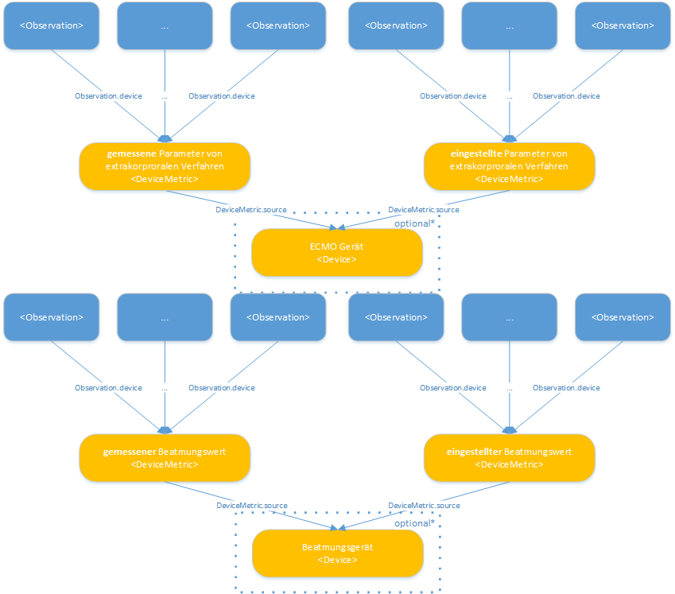
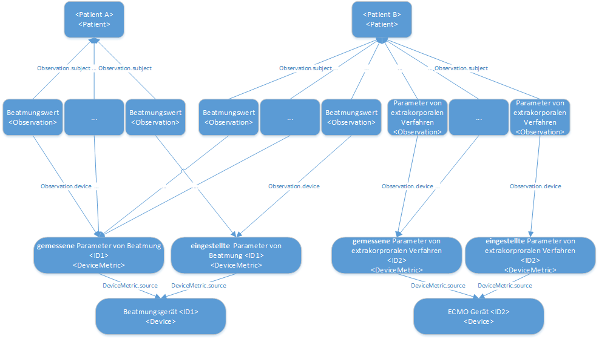

# Profile - MII IG ICU v2027.0.0

* [**Inhaltsverzeichnis**](toc.md)
* **Profile**

## Profile

### Interaktive Profilübersicht

ℹ️ Die Basisprofile der Familie **Monitoring und Vitaldaten** werden im gematik-Package `de.gematik.isik 6.0.0` gepflegt — die vollständige, versionsgenaue Liste steht unten in der bernsteinfarbenen Sektion [ISiK-gehostete Profile](#isik-hosted-profiles).

**Modul-eigene Profile — dieses Paket**

**Körpermaße in den modul-eigenen Monitoring-Profilen**

Das modul-eigene Basisprofil für Monitoring und Vitaldaten übernimmt die Elementregeln aus ISiK 6.0.0 und bindet die Messcodes erweiterbar (extensible) an die MII-ValueSets. Körperlänge im Liegen, Körperlänge bei Geburt und Geburtsgewicht leiten unabhängig von diesem Basisprofil ab und verwenden ausschließlich messungsspezifische Codes. Sie erheben keinen Anspruch auf Konformität zu den deutschen oder den FHIR-Profilen für Körpergröße und Körpergewicht, die die allgemeinen LOINC-Codes verlangen.

Körpergröße und allgemeines Körpergewicht behalten ihre deutschen Elternprofile und schließen die geerbten geburtsspezifischen LOINC-Slices aus. Die Körperlänge im Liegen verlangt LOINC 8306-3 und SNOMED CT 1149101003, die Körperlänge bei Geburt SNOMED CT 169886007 und das Geburtsgewicht LOINC 8339-4 und SNOMED CT 364589006. LOINC 8302-2 ist bei der Körperlänge bei Geburt ausgeschlossen, 29463-7 beim Geburtsgewicht. Die verpflichtenden IEEE-11073-Codes sind 68060, 68058 beziehungsweise 68059. Größe und Länge werden als Quantity in cm angegeben, das Gewicht als Quantity in kg.

**Validator-Kompatibilität:** Die Körperlänge im Liegen verlangt zusätzlich den allgemeineren LOINC-Code 8302-2 (Body height), weil der HL7-Java-Validator im IG Publisher 2.3.2 ihn fordert, sobald 8306-3 vorhanden ist. LOINC 8306-3 bleibt der genauere Code für die Körperlänge im Liegen (NRA-592).

Terminologie-Versionen für die fünf Körpermaß-Profile: LOINC 2.83, SNOMED CT International 2026-07-01 (`http://snomed.info/sct/900000000000207008/version/20260701`) und IEEE-11073-MDC-Nomenklatur 2024-12-05. Jedes Mess-Coding muss seine festgelegte Version enthalten; das IEEE-Mess-Coding ist in jedem dieser Profile verpflichtend.

**ISiK-gehostete Profile — de.gematik.isik 6.0.0**
Von der gematik gehostet und versioniert; dieser Leitfaden listet sie als fachlichen Bestandteil des KDS Intensivmedizin. Aus der gepinnten Paketversion generiert — die Liste ändert sich nur mit einem bewussten Pin-Wechsel. Jeder Link öffnet das in diesem Leitfaden gerenderte Profil (Differential, Snapshot, Must Support, Definitionen); die Profile selbst bleiben im ISiK-Paket.

> Die Profile zu Monitoring und Vitaldaten dieses Moduls sind im ISiK-Paket `de.gematik.isik` (6.0.0) als `sd-mii-icu-*` veroeffentlicht. Sie sind nicht Teil des Pakets dieses Guides; der Guide rendert sie aus dem gepinnten ISiK-Paket auf je einer Seite pro Profil. Der Quell-Guide fuehrte je Profil eine Seite; diese enthielten nur den Verweis auf das generische Profil, der unten einmal erhalten ist, gefolgt von der vollstaendigen Profilliste.

> Original-Wortlaut der Quellseiten (je Profil): „Dies ist eine Ausprägung des generischen Profils zu Monitoring und Vitaldaten (Observation). Siehe dort für nähere Informationen hinsichtlich Erklärungen der Items, oder Bezug der Einträge in der FHIR-Ressource zum Logical Model."Für die pulsatilen Drücke zusätzlich: „Es handelt sich hier um einen pulsatilen Druck. Für diesen gelten neben den Eigenschaften des generischen Profils zu Monitoring und Vitaldaten (Observation) die Eigenschaften des generischen Profils zu Sonstige pulsatile Drücke (Generisch) (Observation)."

Die einzelnen Profile sind Auspraegungen des generischen Profils [Monitoring und Vitaldaten (Observation)](extern-sd-mii-icu-monitoring-und-vitaldaten.md). Siehe dort fuer naehere Informationen zu den Items und zum Bezug auf das Logical Model.

Die FHIR-Profile in diesem Projekt folgen folgendem Ansatz:

Es gibt jeweils mindestens ein **generisches Profil** für die im Datenmodell definierten "Struktur-Elemente" des KDS-Moduls. Diese Profile enthalten ValueSets und beschreiben die vorgegebene **Struktur für Gruppen von Items einer bestimmte intensivmedizinischen Kategorie**. Die generischen Profile sind die ersten in einer jeden Gruppe der Baumstruktur dieses Guides, also:

* Parameter von extrakorporalen Verfahren: - [Extrakorporale Verfahren (Procedure)](StructureDefinition-mii-pr-icu-extrakorporales-verfahren.md) - [Eingestellte und gemessene Parameter (DeviceMetric)](StructureDefinition-mii-pr-icu-dm-eingest-gem-parameter-extrakorporale-verfahren.md) - [Parameter von extrakorporalen Verfahren (Observation)](RETIRED)
* Beatmungswerte: - [Beatmung (Procedure)](StructureDefinition-mii-pr-icu-beatmung.md) - [Eingestellte und gemessene Parameter (DeviceMetric)](StructureDefinition-mii-pr-icu-dm-eingest-gem-parameter-extrakorporale-verfahren.md) - [Parameter von Beatmung (Observation)](RETIRED)
* Monitoring und Vitaldaten - [Monitoring und Vitaldaten (Observation)](profiles.md) - [Sonstige pulsatile Drücke Generisch (Observation)](profiles.md) - [Körpertemperatur Generisch (Observation)](profiles.md)
* Bilanzen - [Bilanz (Observation)](extern-mii-pr-icu-bilanz.md)

Außerdem gibt es **spezifische Profile**, welche jeweils die Code- und Einheiten-Zugehörigkeiten **fixieren**. Diese Spezifischen Ressourcen sind unter anderem als **Handreichung für den Implementierer** gedacht und sollen dabei helfen, die Hürde der korrekten semantischen Annotation zu verringern und die Interoperabilität zu verbessern. Die spezifische Profile sind all jene, die sich innerhalb einer Gruppe an die o.g. generischen Profile anschließen.

### Geräteinformationen

Wir betrachten **messende sowie eingestellte Geräte** (siehe auch [Beschreibung Modul](index.md)). Dies stellt das Mindestmaß an Unterscheidung dar, die wir zur Abbildung der in diesem Modul modellierten Daten benötigen. Die Information, ob der Wert gemessen, oder eingestellt ist, trägt die DeviceMetric. Welches Gerät eingestellt wird bzw. einen Wert misst, beschreibt eine Device-Ressource. Das Device wird aus der DeviceMetric heraus referenziert. Je nach Menge der verfügbaren Informationen bieten sich hier verschiedene Modellierungslevel an:

## 1. keine Geräteinformationen

 Für eine Gruppe von Werten, die sich eine gemeinsame Messmethode und ein gemeinsames Messgerät teilen, kann ein gemeinsames solches Paar aus DeviceMetric und Device angelegt werden, welches aus Observation.device heraus referenziert wird. Dies ins insbesondere dann notwendig, wenn keine Geräteinformationen vorhanden sind.

Sofern keine Geräteinformarmationen vorhanden sind, kann man sich pro Kategorie (Vitaldaten, extrakorporale Verfahren, …) auf jeweils zwei DeviceMetrics beschränken, die jeweils aussagen, ob es sich bei einer Observation (genauer Observation.value) um einen eingestellten oder gemessenen Wert handelt.

Zusammenfassend brauchen wir je eine Ressourcen für jede Kombination aus Observation.type und Observation.category.

| Feld | Bedeutung | | — | — | | Observation.type | Enspricht der Observation.category der referenzierenden Observation. Beachte die entsprechenden ValueSets

* [extrakorporale Verfahren](StructureDefinition-mii-pr-icu-parameter-von-extrakorporalen-verfahren.md) (Snomed- [Code 182744004](https://browser.ihtsdotools.org/?perspective=full&conceptId1=182744004&edition=MAIN/2022-05-31&release=&languages=en) )
*  

| |
| :--- |
| [Beatmung](https://simplifier.net/editguide/miiigintensivmedizin-de/editor?filepath=MII-IG-Modul-ICU/TechnischeImplementierung/FHIR-Profile/ParametervonextrakorporalenVerfahren)(siehe[MII_VS_Category_Procedure_Beatmung_SNOMED](https://simplifier.net/medizininformatikinitiative-modul-intensivmedizin/mii-vs-icu-category-procedure-beatmung-snomed)) |

 

| | |
| :--- | :--- |
| Observation.category | gemessen/eingestellt/… |

## 2. Gerätetyp

Entsprechend der beiden mit "optional*" markierten Felder unter 1. kann man außerdem Device-Ressourcen erzeugen. Dies macht insbesondere dann Sinn, wenn man zusätzliche Informationen für Geräteklassen angeben kann, wie bspw. den gleichen Hersteller für alle Beatmungsgeräte.

## 3. Geräteeigenschaften

 Sollten zu den messenden und eingestellten Geräten weitere Informationen bekannt sein, oder gar Geräte-IDs kommuniziert werden, so kann für jedes so über eine Geräte-ID identifizierbare Gerät eine eigene Ressource angelegt werden. Obiges Schaubild versucht, die möglichen Beziehungen zu illustrieren. Einerseits kann ein Gerät (DeviceMetric und Device) im Laufe der Zeit Werte für unterschiedliche Patienten erzeugen, andererseits können zur selben Zeit für einen einzelnen Patienten mehrere Geräte Werte liefern.

**Beachte:** weil ein Device in der gewählten Modellierung immer nur via eine übergeordnete DeviceMetric referenziert werden kann ergibt sich im Umkehrschluss, dass bei dieser detaillierten Implementierung für jede Device-Ressource eine zugehörige DeviceMetric (bzw. ein Pärchen für gemessene und eingestellte Parameter) erzeugt werden muss.

