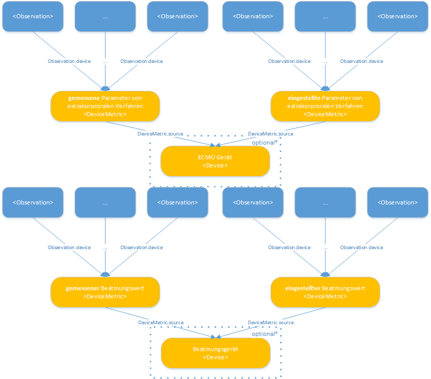
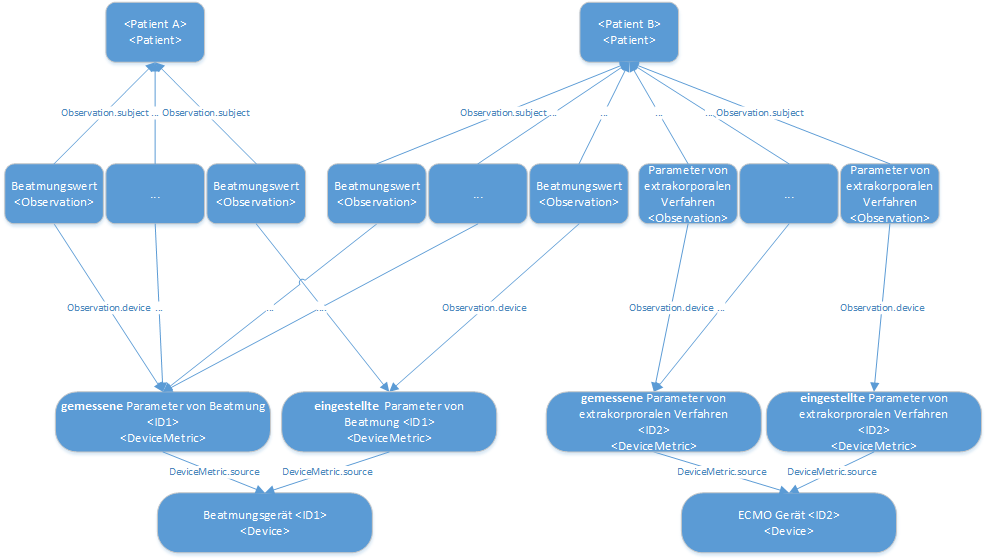

# Profiles - MII IG ICU v2027.0.0

* [**Table of Contents**](toc.md)
* **Profiles**

## Profiles

### Interactive profile map

ℹ️ The **Monitoring and Vital Signs** base profiles of this module are maintained in the gematik package `de.gematik.isik 6.0.0` — see the amber section [ISiK-hosted profiles](#isik-hosted-profiles) below for the complete, version-pinned list.

**Module-owned profiles — this package**

**Body measurements in the module-owned monitoring profiles**

The module-owned monitoring base retains the ISiK 6.0.0 element rules with extensible MII measurement-code bindings. Recumbent body length, birth length and birth weight derive independently from this base and use only measurement-specific codes. They do not claim conformance to the German or FHIR body-height/body-weight profiles, which require the general LOINC codes.

Body height and general body weight retain their German parent profiles and prohibit the inherited birth-specific LOINC slices. Recumbent length requires LOINC 8306-3 and SNOMED CT 1149101003; birth length requires SNOMED CT 169886007; birth weight requires LOINC 8339-4 and SNOMED CT 364589006. LOINC 8302-2 is excluded from birth length, and 29463-7 is excluded from birth weight. Required IEEE 11073 codes are 68060, 68058 and 68059, respectively. Height and length use Quantity in cm, weight uses Quantity in kg.

**Validator compatibility:** Recumbent length also requires the broader LOINC 8302-2 (Body height) because the HL7 Java validator bundled with IG Publisher 2.3.2 requires it when 8306-3 is present. LOINC 8306-3 remains the more precise code for recumbent length (NRA-592).

Terminology editions for the five body-measurement profiles: LOINC 2.83, SNOMED CT International 2026-07-01 (`http://snomed.info/sct/900000000000207008/version/20260701`), and IEEE 11073 MDC nomenclature 2024-12-05. Each measurement Coding must include its fixed version; the IEEE measurement coding is required in each profile.

**ISiK-hosted profiles — de.gematik.isik 6.0.0**
Hosted and versioned by gematik; this guide lists them as clinical content of the ICU core data set. Generated from the pinned package version — the list only changes with a deliberate pin bump. Each link opens the profile rendered in this guide (differential, snapshot, must support, definitions); the profiles themselves stay in the ISiK package.

> The Monitoring and Vital Signs profiles of this module are published inside the ISiK package `de.gematik.isik` (6.0.0) as `sd-mii-icu-*`. They are not part of this guide's package; this guide renders them from the pinned ISiK package on one page per profile. The source guide carried one page per profile; those pages contained only the generic-profile reference sentence, which is preserved below once, followed by the complete profile list.

> Original wording of the source pages (per profile): ""Body weight (Observation)" is a characteristic of the generic profile for monitoring and vital data (Observation). See there for more detailed information regarding explanations of the items or reference of the entries in the FHIR resource to the Logical Model."For the pulsatile pressures additionally: "This is a pulsatile pressure. In addition to the properties of the generic profile for Monitoring and vital data, the special features described on the page of the profile for other pulsatile pressures generic (Observation) also apply to this. See there for more detailed information regarding explanations of the items or reference of the entries in the FHIR resource to the Logical Model."

The individual profiles are characteristics of the generic profile [Monitoring and vital data (Observation)](extern-sd-mii-icu-monitoring-und-vitaldaten.md). See there for details on the items and their relation to the Logical Model.

The FHIR profiles in this project follow the following approach:

There is at least one **generic profile** for each of the "structure elements" of the KDS module defined in the data model. These profiles contain ValueSets and describe the predefined **structure for groups of items in a specific intensive care category**. The generic profiles are the first in each group of the tree structure of this guide, i.e:

* Parameters of extracorporeal procedures: - [Extracorporeal procedures (Procedure)](StructureDefinition-mii-pr-icu-extrakorporales-verfahren.md) - [Set and measured parameters (DeviceMetric)](StructureDefinition-mii-pr-icu-dm-eingest-gem-parameter-extrakorporale-verfahren.md) - [Parameters of extracorporeal procedures (Observation)](StructureDefinition-mii-pr-icu-parameter-von-extrakorporalen-verfahren.md)
* Ventilation values: - [Ventilation (Procedure)](StructureDefinition-mii-pr-icu-beatmung.md) - [Set and measured parameters (DeviceMetric)](StructureDefinition-mii-pr-icu-dm-eingest-gem-parameter-extrakorporale-verfahren.md) - [Ventilation parameters (Observation)](StructureDefinition-mii-pr-icu-parameter-von-beatmung.md)
* Monitoring and vital data - [Monitoring and vital data (Observation)](profiles.md) - [Other pulsatile pressures generic (Observation)](profiles.md)

There are also **specific profiles**, which **fix** the code and unit affiliations. These specific resources are intended, among other things, as a **handout for the implementer** and should help to reduce the hurdle of correct semantic annotation and improve interoperability. The specific profiles are all those that are connected to the above-mentioned generic profiles within a group.

### Device information

We consider **measuring and pre-set devices** (see [module description](index.md)). This is the minimum level of differentiation we need to map the data modelled in this module. The DeviceMetric carries the information whether the value is measured or set. A device resource describes which device is set or measures a value. The device is referenced from the DeviceMetric. Depending on the amount of information, available, different modelling levels are available here:

## 1. No device information

 For a group of values that share a common measurement method and a common measurement device, a common pair of DeviceMetric and Device can be created and referenced from Observation.device. This is particularly necessary if no device information is available.

If there is no device information available, you can limit yourself to two DeviceMetrics per category (vital data, extracorporeal procedures …), each of which states whether an observation (more precisely Observation.value) is a set or measured value.

In summary, we need one resource for each combination of Observation.type and Observation.category.

| Field | Meaning | | — | — | | Observation.type | Corresponds to the Observation.category of the referencing observation. Note the corresponding ValueSets

* [extrakorporal procedures](StructureDefinition-mii-pr-icu-parameter-von-extrakorporalen-verfahren.md) (Snomed- [Code 182744004](https://browser.ihtsdotools.org/?perspective=full&conceptId1=182744004&edition=MAIN/2022-05-31&release=&languages=en) )
*  

| |
| :--- |
| [ventilation](StructureDefinition-mii-pr-icu-dm-eingest-gem-parameter-extrakorporale-verfahren.md)(siehe[MII_Category_Procedure_Beatmung_SNOMED](https://simplifier.net/medizininformatikinitiative-modul-intensivmedizin/mii-vs-icu-category-procedure-beatmung-snomed)) |

 

| | |
| :--- | :--- |
| Observation.category | measured/set/… |

## 2. Type of device

You can also create device resources according to the two fields marked "optional*" under 1. This is particularly useful if you can specify additional information for device classes, such as the same manufacturer for all ventilators.

## 3. Device properties

 If further information is known about the measuring and set devices, or even device IDs are communicated, a separate resource can be created for each device that can be identified in this way via a device ID. The diagram above attempts to illustrate the possible relationships. On the one hand, a device (DeviceMetric and Device) can generate values for different patients over time; on the other hand, several devices can provide values for a single patient at the same time.

**Note:** As a device can only ever be referenced by a higher-level DeviceMetric in the selected modelling, the reverse conclusion is that with this detailed implementation, an associated DeviceMetric (or a pair for measured and set parameters) must be created for each device resource.

